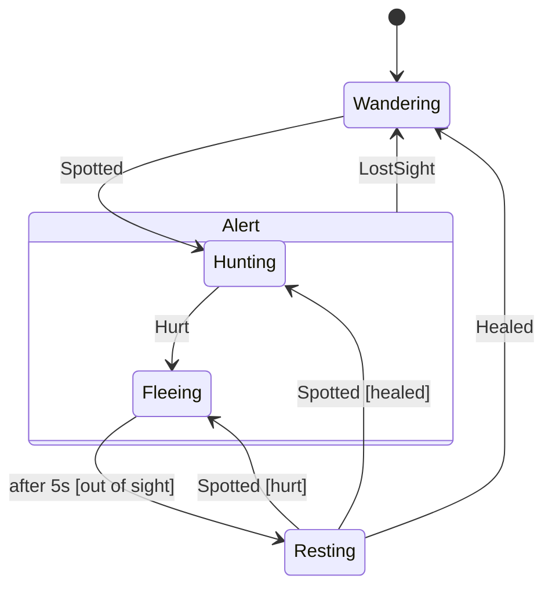

# Fluffy

Fluffy is a small finite state machine engine (`src/Fluffy`): plain C#, no dependencies, so it works in game code,
tools and tests alike. States and triggers can be any type with equality; enums are the usual choice.

```csharp
enum Door { Open, Closed, Locked }
enum Act { Push, Pull, Lock, Unlock }

var door = new StateMachine<Door, Act>(Door.Open);
door.Configure(Door.Open)
    .Permit(Act.Push, Door.Closed);
door.Configure(Door.Closed)
    .OnEnter(t => Console.WriteLine($"Closed (was {t.Source})"))
    .Permit(Act.Pull, Door.Open)
    .PermitIf(Act.Lock, Door.Locked, () => hasKey, "has key");
door.Configure(Door.Locked)
    .Permit(Act.Unlock, Door.Closed);

door.Fire(Act.Push);       // Closed (was Open)
door.CanFire(Act.Lock);    // true if hasKey
door.TryFire(Act.Unlock);  // false: nothing answers Unlock while Closed
```

## What a state can do

| Call | Meaning |
|---|---|
| `Permit(trigger, state)` | Move on the trigger. To the same state: leave and enter it again (`IsReentry`) |
| `PermitIf(trigger, state, guard, "name")` | Move only while the guard holds; the first handler whose guard holds wins |
| `PermitDynamic(trigger, () => state)` | Pick the destination when the trigger fires |
| `InternalTransition(trigger, action)` | Run an action without leaving or entering anything |
| `Ignore(trigger)` | Accept the trigger and do nothing |
| `OnEnter(action)`, `OnExit(action)` | Run when entering or leaving; the action gets the `Transition` (source, destination, trigger) |
| `After(delay, state)` | Move once the machine has spent `delay` in the state, counted by `Update(elapsed)` |
| `SubstateOf(state)` | Nest: inherit the superstate's triggers and timers |
| `InitialTransition(substate)` | Entering this state carries on into the substate |

A trigger nothing answers throws `UnhandledTriggerException` (with the names of any guards that said no), unless
`OnUnhandled` is set; `TryFire` returns false instead.

## Nesting

A substate answers its superstate's triggers unless it handles them itself first, and time spent in it counts for
the superstate's timers. Entry and exit actions of a superstate only run when a transition crosses its border:
moving between two substates leaves the superstate alone. `IsIn(state)` is true for the current state and all its
superstates; `ActiveStates` lists them innermost first.

## Running to completion

A trigger fired from inside an entry, exit or transition action is queued and handled after the current transition
has finished, so actions never see the machine half-way. Every transition raises `Transitioned`. The machine enters
its initial state (running its entry actions) on `Start()`, or by itself on the first `Fire` or `Update`.

## Checking and drawing

`Validate()` reports states that can never be reached and initial transitions that do not lead to a substate.
`ToMermaid()` and `ToDot()` draw the machine, as a Mermaid state diagram (GitHub renders it in markdown) or for
Graphviz. Here is the cave spiders' brain in Mossbrook (`Jentl.Rpg.World.SkittishBrain`), drawn by `ToMermaid()`:



The spider's turn senses the world, fires triggers, lets one second pass on the machine's clock (so `After` counts
turns), and then acts on its state: hunting walks towards the player and bites, fleeing steps away (biting back
when cornered), resting heals a point a turn.
